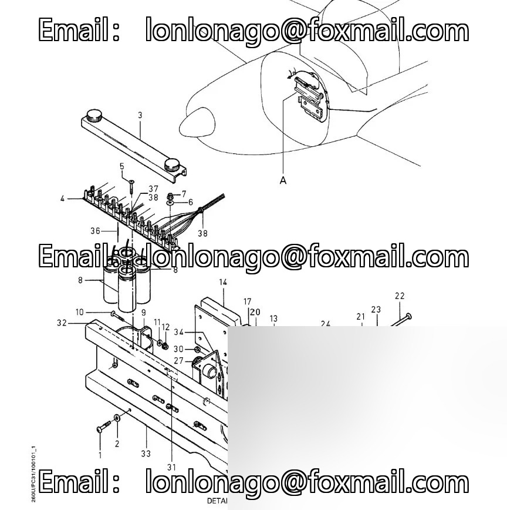
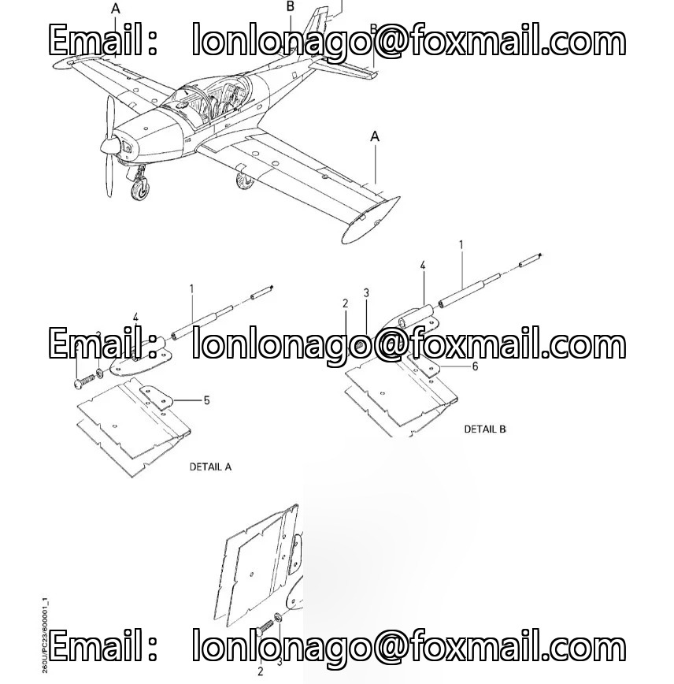
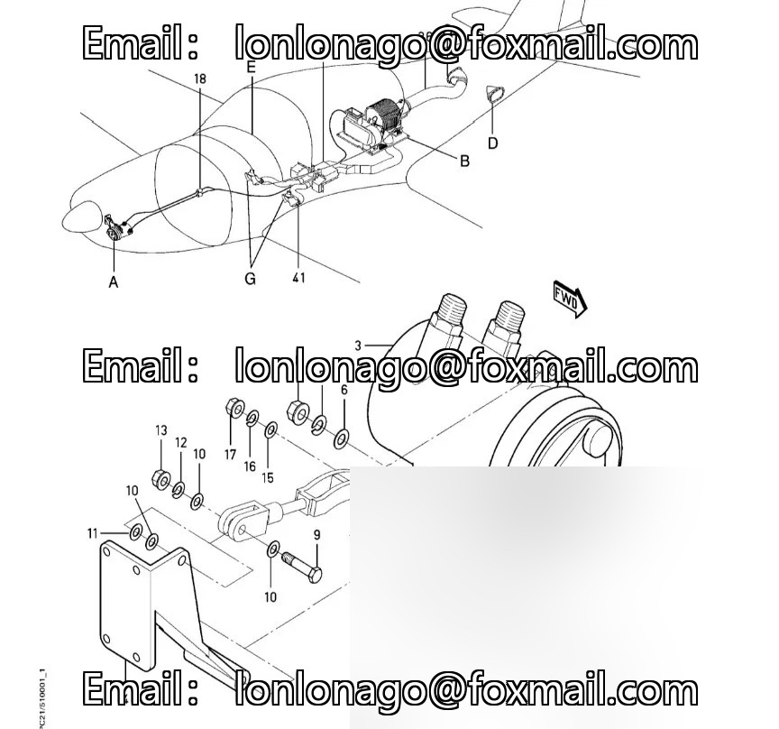

# Aermacchi (Aermacchi Airlines, now part of the Loneyada Group) published

## Body

The electronic PDF file of the F260EU aircraft diagram and part catalog published by Aermacchi (Aeromacchi Airline Group, currently part of the LoneStar Group), with 630 pages.

F260EU is the military or export version of the SF.260 series aircraft produced by Italy's renowned aircraft manufacturer Aermacchi (which was previously merged with SIAI-Marchetti). "EU" typically refers to its specific European or military configuration.

Electronic data, upon sale.
567947111-SF26

Aermacchi (the airline now under the Leonardo group) publishes the F260EU aircraft diagram parts catalog PDF, which has 630 pages.

<!-- AI_ENRICHED -->

## Images

## Payment

Here is a pay link on Stripe ( https://buy.stripe.com/3cs8yP7sY87d0vu9AB ). Please contact me lonlonago@foxmail.com after funding $89, and I will send you a complete data files , thank you!

